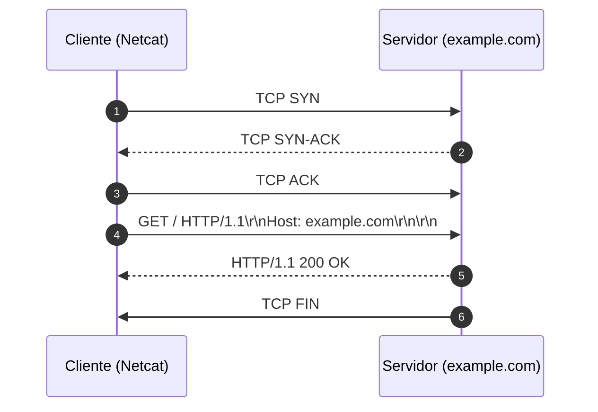

# Memória de Desenvolvimento — Semana 01
**Aluno:** Gabrielly Torres  
**Curso:** Engenharia da Computação  

---

## 1. Mapeamento da Camada de Transporte
Diagrama Mermaid demonstrando o ciclo de vida da requisição executada no laboratório:

---

## 2. Captura Bruta e Análise do Protocolo
* **Comando Utilizado:** `nc -C example.com 80`
* **Status Line Retornada:** `HTTP/1.1 200 OK`

### Análise dos Headers Recebidos:
1. **`Content-Type`:** text/html; charset=utf-8 — O MIME type retornado indica que o corpo da resposta contém um documento HTML, enquanto o parâmetro charset=utf-8 especifica a codificação dos caracteres. Essa informação é importante para que o navegador ou parser interprete corretamente o conteúdo recebido, reconhecendo as tags HTML e os caracteres presentes no documento.
2. **`Content-Length`:** O cabeçalho Content-Length não foi informado. Em seu lugar, o servidor utilizou Transfer-Encoding: chunked, mecanismo que transmite o corpo da mensagem em blocos, precedidos por seus respectivos tamanhos em hexadecimal. O término do corpo é indicado por um bloco de tamanho zero. Dessa forma, o cliente consegue identificar o fim do conteúdo recebido sem depender exclusivamente do fechamento da conexão TCP.
3. **`Connection: close`:** Esse cabeçalho indica que a conexão TCP será encerrada depois da conclusão da resposta. Diferente do comportamento persistente associado a keep-alive, em que a conexão pode ser reutilizada para outras requisições HTTP, o modo close exige o encerramento da conexão ao final da comunicação. Isso significa que, após receber a resposta completa, o cliente precisará estabelecer uma nova conexão TCP para realizar outra requisição ao servidor.

---

## 3. Conclusão Técnica
Compreender o HTTP é importante para entender como os dados são enviados entre um cliente e um servidor pela rede. No HTTP/1.1, as informações são transmitidas por uma conexão TCP, começando com uma linha de status, seguida pelos cabeçalhos e pelo conteúdo da resposta. Essas partes são organizadas por sequências de CRLF (\r\n), que indicam as quebras de linha e ajudam a identificar onde os cabeçalhos terminam e onde começa o corpo da mensagem. Diferentemente de um arquivo salvo no computador, que já está armazenado e possui um tamanho definido, uma resposta HTTP é recebida pela rede e precisa ser interpretada durante a transmissão. No exemplo analisado, o servidor utilizou Transfer-Encoding: chunked para enviar o conteúdo em blocos, informando o tamanho de cada um até chegar ao bloco final, de tamanho zero. Entender esse funcionamento permite que programas processem os dados corretamente, gerenciem conexões persistentes (Keep-Alive) e utilizem melhor a memória. Além disso, interpretar incorretamente o início e o fim das mensagens pode causar falhas de segurança, como o HTTP Request Smuggling, que ocorre quando sistemas interpretam de maneiras diferentes os limites das requisições HTTP.
